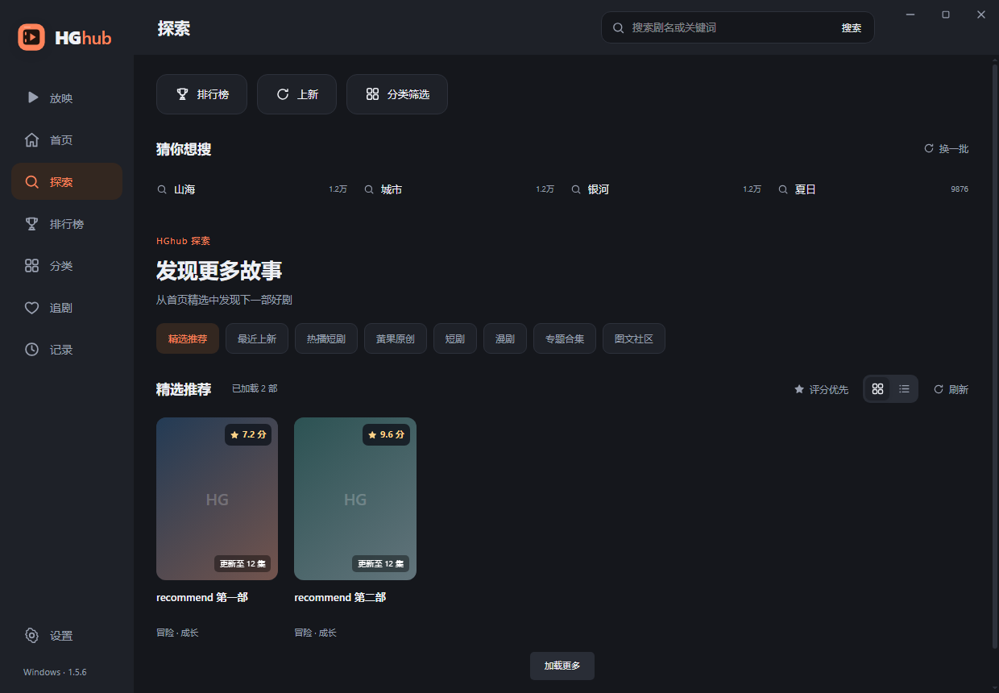
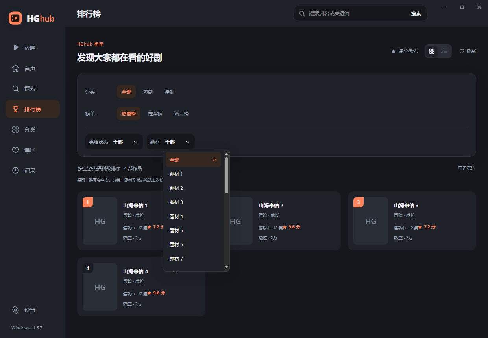
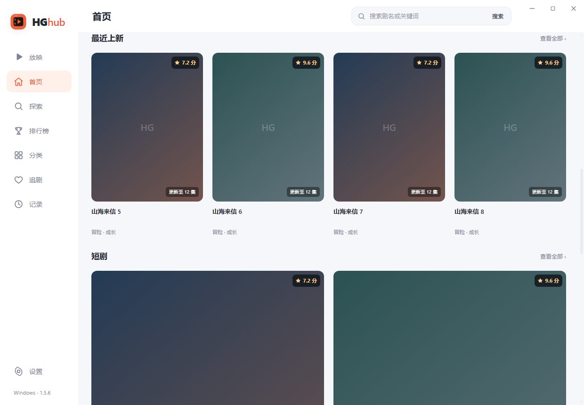
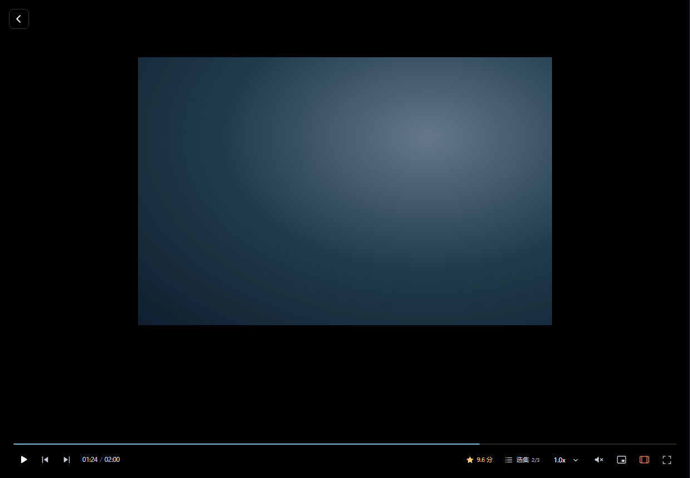
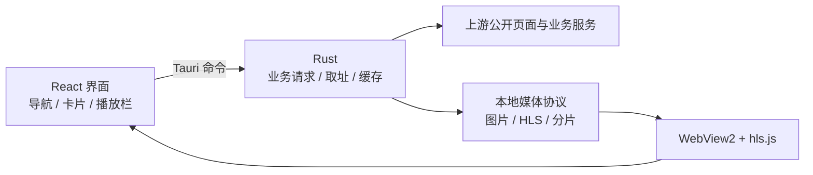

# HGhubL

<div align="center">


### 让浏览更清楚，让放映更专注

**ENIAC 维护的 HGhub 桌面适配版 · 保留 Tauri + Rust + React 架构**

[](https://github.com/lhl1/HGhubL/releases/latest)
[](https://github.com/lhl1/HGhubL/releases/latest)
[](https://github.com/lhl1/HGhubL/actions/workflows/verify.yml)
[](LICENSE)

[下载使用](https://github.com/lhl1/HGhubL/releases/latest) · [功能介绍](#能做什么) · [实现细节](docs/architecture.md) · [遇到问题](docs/troubleshooting.md) · [更新记录](CHANGELOG.md)

</div>

HGhubL 在原 HGhub 基础上，集中改进 **播放兼容、无边框窗口、全屏隐藏、首页探索和选片效率**。打开软件直接进入“放映”；想找作品时，可以浏览首页、探索、分类、专题和排行榜，再根据接口综合分挑选。

本仓库是独立适配版本，原项目来自 [Minireel/HGhub](https://github.com/Minireel/HGhub)。应用中保留 HGhub 名称，设置署名为 **ENIAC**。本项目不提供视频内容，也不代表上游项目或内容站点。来源与许可见 [NOTICE](NOTICE.md)。

## 三步开始

1. 打开 [Releases 下载页](https://github.com/lhl1/HGhubL/releases/latest)，下载 `HGhubL_1.5.8_windows_x64_portable.zip`。**只运行软件，无需下载源码包。**
2. 完整解压到一个文件夹，双击 `HGhub.exe`。请让 `WebView2Loader.dll` 与 EXE 保持同目录。
3. 默认进入放映；在左侧切换首页、探索、排行榜或分类。外观默认跟随系统，也可在设置中手动切换。

| 文件 | 用途 |
| --- | --- |
| `HGhubL_1.5.8_windows_x64_portable.zip` | Windows x64 便携版，解压运行 |
| `HGhubL_1.5.8_source.zip` | 对应发布提交的源码，供开发与复核 |
| `SHA256SUMS.txt` | 发布文件的 SHA-256 校验值 |
| `validation.json` | 本次构建与检查范围 |

运行依赖 Windows WebView2 Runtime；缺失时可从 [微软官方下载页](https://developer.microsoft.com/microsoft-edge/webview2/) 安装 Evergreen Runtime。本次提供的可执行文件为 Windows x64 构建；macOS、Android 保留工程入口，**本轮没有提供或验证对应安装包**。

可用 PowerShell 核对下载文件：

```powershell
Get-FileHash .\HGhubL_1.5.8_windows_x64_portable.zip -Algorithm SHA256
```

将输出与同一 Release 中的 `SHA256SUMS.txt` 对照。升级时先退出旧版，再解压到新目录，保留旧目录便于回退；收藏、记录和设置仍使用原应用标识对应的数据目录。

## 能做什么

| 入口 / 功能 | 使用体验 |
| --- | --- |
| **放映** | 默认启动页、导航首位，支持推荐 / 短剧 / 漫剧频道和连续浏览 |
| **首页** | 精选轮播、快捷入口、热门标签、推荐、上新、热播、专题 |
| **探索** | 推荐、上新、热播、原创、短剧、漫剧、专题、图文；原创还有三个子分区 |
| **分类与排行榜** | 分类、题材、完结状态筛选，卡片 / 详细列表切换，保留榜单原始名次 |
| **评分优先** | 综合分直接显示；已加载作品按分数降序，无评分排后，同分保留原顺序 |
| **播放栏选集** | 底部向上展开，支持集数 / 标题查找、倒序和键盘操作，不挤占画面 |
| **透明播放控制区** | 底部控制条全透明，无底色、渐变和模糊；按钮及进度条清晰显示 |
| **全屏与全屏窗口** | 隐藏顶部、侧栏、说明和社交元素，操作时短暂显示底部控件 |
| **播放偏好** | 自动播放、自动下一集、倍速、音量、增强缓冲与播放前预览 |
| **本地记录** | 追剧、观看进度、搜索历史；清理媒体缓存时保留这些数据 |
| **外观** | 暖橙强调色、深浅主题、默认跟随系统、无边框窗口 |

**评分用于选片。** 当前没有个人打分入口，也不会向上游提交评分。“评分优先”针对当前已加载作品；继续加载后会重新排序，它不是全站评分榜。首页按各原有板块分别排序，排行榜的封面数字仍是原榜名次。

### 界面预览

以下图片使用离线演示数据和占位封面，只展示布局，不包含真实视频画面。

| 探索与内容分区 | 榜单筛选与首次展开的下拉菜单 |
| --- | --- |
|  |  |





## 播放与快捷键

- **F**：全屏；**T**：全屏窗口。进入即隐藏界面，明确移动鼠标后显示底部控件，闲置约 **1.2 秒**再次隐藏。
- 拖动进度、音量或展开菜单时，控件保持可用；暂停后也会自动隐藏。
- **全屏窗口返回**：左上角显示返回按钮，随控件自动隐藏；顶部整条区域可拖动移动窗口。
- **全屏窗口滚轮**：上滚上一集，下滚下一集；一次手势只切一集，带 700ms 冷却，首末集停住。
- **Esc / 返回**：优先退出全屏或全屏窗口，保持当前视频；普通模式再按返回才离开播放页。
- **空格**：播放 / 暂停；**左右方向键**：快退 / 快进；**M**：静音；**Q / E**：上一集 / 下一集。
- **Alt + 1 / 2 / 3 / 4**：放映 / 首页 / 探索 / 分类；**/**：搜索。

这些按键受当前焦点、菜单状态和系统环境影响。全屏切换的回归检查会验证视频、集数、进度、倍速、音量和媒体节点保持不变；检查范围见 [验证说明](docs/verification.md)。

## 它是如何实现的

没有把网页直接套进窗口。应用仍由三层组成：



1. **React 管界面与状态。** 全屏、播放、选集和导航各自保存状态，切换展示模式不会重新创建视频。
2. **Rust 管网络和媒体。** 统一处理线路、系统代理、请求校验、播放取址、封面处理和 HLS 转发。
3. **网页内容转为本地数据。** 对部分失效或不稳定的列表接口，读取对应公开页面，只提取标题、ID、封面、标签、集数和评分，再用本地组件渲染。来源脚本和页面事件不会执行。
4. **分页固定来源。** 同一个列表从第一页到后续页始终使用同一来源，避免网页每页数量与接口每页数量不同造成漏项。
5. **全屏固定逻辑条目。** 窗口尺寸变化时保持当前视频的逻辑索引，再重新对齐像素位置，避免把布局滚动误认成用户切片。

涉及的文件、请求生命周期和边界处理见 [实现详解](docs/architecture.md)。

## 修复过哪些问题

| 现象 | 找到的原因 | 采用的修复 |
| --- | --- | --- |
| 显示“暂无播放地址”，重试无效 | 上游取址流程变化；旧重试只尝试播放已有元素 | 适配当前播放通道，重新取址并重建失败实例，旧回包按请求代次丢弃 |
| 点击全屏后刷新或切换视频 | `scrollTop / clientHeight` 在窗口变高后算成另一个视频 | 维护逻辑选中项，尺寸变化时先对齐再恢复滚动吸附 |
| 播放区域出现两层边框 | 桌面舞台和视频容器都带留白、裁切与装饰 | 移除重复外框，充分使用内容区域；视频保持原比例 |
| 左上角、右上角在全屏里仍有元素 | 隐藏规则分散，页面壳和播放器各管一部分 | 统一沉浸状态，隐藏外壳、角落元素与闲置鼠标 |
| 首页或探索内容不完整 | 部分接口失效，通用排序也不能代表实际原创分类 | 按分区使用原公开页面或可用接口，保留原分页 |
| 不需要搜索推荐区域 | 页面存在“猜你想搜”区块 | 1.5.7 起从首页、探索和分类移除该区块 |
| 下拉框第一下闪退，第二下才正常 | `scrollIntoView` 连带滚动外层页面，触发外部滚动关闭 | 定位后只滚动弹层自己的 `scrollTop` |
| 上新等标题贴住封面 | 板块标题缺少统一的下间距 | 标题与内容保留 18px 间距 |
| 切页太快显示旧数据 | 之前的异步请求晚返回 | 请求代次隔离、重复请求合并、卸载清理 |
| 应用图标仍是旧版 | 只换界面 SVG，EXE 的原生资源没变 | 生成多尺寸 ICO / PNG / ICNS，重新编译并逐项核对 EXE 图标 |

这些修复分别有针对性的行为检查。面向使用者的操作建议见 [排障指南](docs/troubleshooting.md)，逐版本变更见 [CHANGELOG](CHANGELOG.md)。

## 从源码运行

**推荐环境：** Node.js 22、pnpm 10、Rust stable（至少 1.90），Windows 上安装 Visual Studio C++ Build Tools 和 WebView2。项目也兼容本地已验证的 Windows GNU 工具链。

```powershell
git clone https://github.com/lhl1/HGhubL.git
cd HGhubL
pnpm install --frozen-lockfile
pnpm app:dev
```

前端单独调试：

```powershell
pnpm dev --host 127.0.0.1
```

浏览器可查看页面和离线测试夹具；真实业务依赖 Tauri 的 Rust 命令，单独在浏览器打开不等同于完整客户端。

构建便携程序：

```powershell
node node_modules/@tauri-apps/cli/tauri.js build --no-bundle
```

主程序位于 `src-tauri/target/release/huangguo-client.exe`。本次 GNU 便携包同时附带 `WebView2Loader.dll`。需要安装包时可使用 `pnpm app:build`，但本次 Release 提供的是便携版，未附 NSIS 安装包。

<details>
<summary>其他平台、图标和磁盘兼容</summary>

- macOS：安装 Xcode Command Line Tools，使用 `pnpm tauri build --config src-tauri/tauri.macos.conf.json`；本轮未验证。
- Android：配置 JDK、SDK、NDK 后运行 `pnpm android:init`、`pnpm android:dev` 或 `pnpm android:build`；工程保留，发布签名由开发者自行配置，本仓库不包含签名密钥。
- 重新生成图标：`node node_modules/@tauri-apps/cli/tauri.js icon public/logo.svg -o src-tauri/icons`。Android 生成工程的图标同步由现有构建脚本处理。
- exFAT 不支持符号链接，项目保留 `node-linker=hoisted`。pnpm 10 使用 `.npmrc` 和构建白名单，pnpm 11 的相应配置在 `pnpm-workspace.yaml`。

</details>

## 检查与验证

```powershell
pnpm build
cargo test --locked --manifest-path src-tauri/Cargo.toml --lib
./scripts/test-browser.ps1
```

Windows GNU 测试环境若缺少 Common Controls v6 manifest，改用：

```powershell
./scripts/test-windows-gnu.ps1
```

当前浏览器行为基线为 **274 项**；Rust 离线基线为 **38 通过、10 项联网测试默认忽略**。发布时以 Release 的 `validation.json` 为准。测试中使用模拟媒体和原生窗口桩，**不能视为本轮 Windows 原生全屏按键实机测试**。macOS / Android 也不在本轮发布验证范围内。

默认测试不会提交评分、登录真实账号或批量请求上游。联网烟测需单独、按需选择；详情见 [验证说明](docs/verification.md)。

## 目录导航

```text
src/                         React / TypeScript 界面
  components/                播放器、选集、评分、菜单、桌面壳
  pages/                     放映、首页、探索、分类、排行榜、设置
  store.tsx                  导航、主题、用户与本地状态
  discovery.ts               页面字段提取与列表归一化
  feed-viewport.ts            尺寸变化时保持当前视频
src-tauri/src/               Rust 后端
  api.rs                     业务命令与 HGhubL 更新检查
  playback.rs                当前播放通道及临时会话
  discovery.rs               公开页面与分区数据源
  media.rs / cache.rs         媒体协议、HLS 处理与有界缓存
  net.rs / network_policy.rs  网络、代理和目标检查
  session.rs                 绑定站点的登录会话
scripts/                     图标同步、浏览器 / GNU 测试工具
tests/                       浏览器行为测试与演示夹具
docs/                        实现、排障、验证及历史修复记录
```

## 数据、限制与反馈

- 内容、分数和可播放状态依赖上游，接口或页面变化可能需要后续适配；不保证所有线路、作品和地区始终可用。
- 收藏、历史、偏好在本地保存。登录会话文件包含令牌，当前未使用系统凭据保险库加密；**请不要公开整个应用数据目录、会话文件或未脱敏日志**。
- 媒体缓存已有容量、条数和过期约束；诊断日志的轮转仍有改进空间。安全模式、代理边界和已知限制见 [安全说明](docs/security.md) 及 [实现详解](docs/architecture.md)。
- 反馈请到 [Issues](https://github.com/lhl1/HGhubL/issues)，写清版本、Windows 版本、发生页面、操作步骤和错误文字。不要附带密码、令牌、Cookie、签名媒体地址或私人记录。
- 维护范围以 Windows 桌面体验为主；更大规模的跨平台实机验证、上游变化适配和日志管理会继续完善。

## 致谢与许可

感谢 [Minireel/HGhub](https://github.com/Minireel/HGhub) 及其贡献者提供原始工程，也感谢 React、Tauri、hls.js、DOMPurify 等依赖项目。

本仓库由 **ENIAC** 维护适配，遵循 [PolyForm Noncommercial 1.0.0](LICENSE)，保留上游 `Required Notice`。允许和限制以许可证原文为准。视频与图片的权利属于各自权利方；本项目不提供、不存储或再分发上游视频内容。
