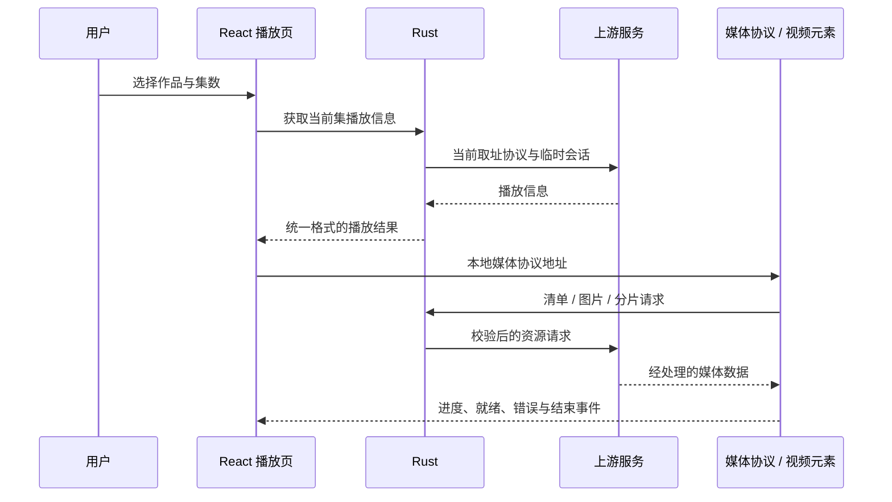

# 实现详解：从页面到播放器

本文对应 HGhubL 1.5.8，说明本轮适配的结构、问题和取舍。按模块读即可，不需要先了解 Tauri。

## 1. 为什么保留原框架

本次目标是修复原程序并改善桌面体验，而不是重新写一个 Electron 客户端。因此继续采用：

| 层 | 负责什么 | 主要文件 |
| --- | --- | --- |
| React + TypeScript | 页面、导航、筛选、播放栏、主题 | `src/pages/`、`src/components/`、`src/store.tsx` |
| Tauri 2 | WebView 与系统窗口、前后端命令桥 | `src-tauri/src/lib.rs`、`tauri.conf.json` |
| Rust | 网络请求、线路、会话、取址、媒体处理、缓存 | `src-tauri/src/` |
| WebView2 + hls.js | 视频元素、HLS 播放与媒体事件 | `VideoSurface.tsx`、`PlayerControls.tsx` |

桌面视觉参考开发时提供的 windows-client，但没有将它的 Electron 运行时迁入。无边框拖动、缩放、最小化和最大化继续调用 Tauri 原生窗口接口。

## 2. 一次播放的路径

### 空地址问题

旧流程出现过“业务成功、分集元数据存在，但播放地址为空”。前端不断重试旧地址自然无法恢复。

修复分两部分：

- `playback.rs` 适配公开前端使用的当前取址通道，使用临时会话和认证加密，并检查响应会话、序号、时间等绑定信息。临时密钥和签名播放信息只在内存中处理。
- React 重试改为重新请求播放信息，而不是仅对可能不存在的 `<video>` 调用 `play()`。返回旧集数时也重新取址，避免长期复用过期签名。

本文只介绍兼容结构，不提供真实用户凭据、临时密钥或可复用的媒体直链。具体实现位于 `playback.rs`，历史排查见 [播放修复记录](playback-fix.md)。

### 旧回包为什么不会串片

用户切片、换集或切线路之后，之前的异步请求仍可能完成。组件和 Rust 都检查请求归属：当前视频、播放键、请求代次、线路或用户状态不一致时，旧结果不会写回当前播放器。

组件卸载时会释放媒体源和待处理操作；自动恢复有次数预算，避免失败时无限循环取址。用户主动重试仍可重新发起正常流程。

### 图片与 HLS

封面处理和 HLS 资源走已有本地媒体协议，前端不直接运行上游页面来播放。HLS 清单中的分片、密钥、子清单等 URI 统一改写到受控的媒体请求入口。数据源切换、清缓存及迟到请求使用代次约束，避免清理后又被旧结果填回。

## 3. 首页与探索如何兼容原网页

部分上游列表接口会失效，通用排序也不能可靠表示原网页的“原创”集合。适配层按内容选择来源：

- 首页、推荐、上新、短剧、漫剧、部分原创/专题/标签列表使用相应公开页面。
- 热播榜、热搜、专题目录、图文分类与文章等保留可用的业务接口。
- 每个列表的整个分页会话固定来源与页大小，不把接口页和网页页混着拼。

Rust 的 `discovery.rs` 对允许的分区路径发起请求，限制页面大小，并沿用线路和网络策略。前端 `discovery.ts` 将响应放进未挂载的惰性 `template`，提取普通字段，再交给本地 React 组件。

**这是数据适配，不是网页嵌入。** 上游脚本、事件、iframe 和追踪页面不会被安装到运行界面。结构变化时显示加载错误，不把解析失败伪装成“没有作品”。

专题、标签、图文分类和三个原创子类各自保留自己的入口。返回播放页之前的列表时，导航栈会保留分区和上下文。

## 4. 为什么全屏曾经会切换视频

原来视频流用 `scrollTop / clientHeight` 估算当前条目。

例如第三个条目的像素偏移在普通窗口中正确；全屏后 `clientHeight` 变大，旧偏移除以新高度，就可能变成第二个条目。布局改变被当作用户主动滚动，继而触发取址和换片。

`feed-viewport.ts` 改为：

1. 先记住当前逻辑视频索引。
2. 监听视口尺寸、全屏状态和窗口变化。
3. 布局重排时暂时关闭吸附与滚动锚定，将当前位置对齐到同一逻辑条目。
4. 布局稳定后恢复正常滚动；只有明确的用户导航才释放保护。

全屏状态只改变布局和显示规则，不作为重新创建媒体节点的键。视频、集数、进度、暂停、倍速和音量均保留。

### 隐藏与返回

`immersive.ts` 统一管理控件显隐。进入沉浸状态即隐藏，明确操作后再显示，闲置约 1.2 秒自动隐藏；暂停同样遵循该规则。细小鼠标抖动不会唤醒，但累计慢速移动可以。

拖动进度和展开菜单时设置保持显示状态；结束操作后恢复计时。外壳和播放器共享沉浸状态，统一隐藏侧栏、窗口按钮、角落标题、社交工具、信息说明、装饰和闲置光标。

返回键由外层优先处理：先退出全屏/全屏窗口，再交给面板、弹窗和普通页面。这样焦点即使在选集或倍速菜单中，也不会直接离开当前视频。

## 5. 播放栏选集

选集从右侧工具栏移到 `PlayerControls`，由 `PlayerTools.tsx` 渲染。

- 浮层向上展开，边界限制在可见区域，不缩小视频。
- 通过 portal 挂到 `document.fullscreenElement`，全屏时仍在全屏容器内部。
- 当前集高亮，支持搜索集数或标题、正倒序、Enter 与方向键。
- 点击当前集只关闭浮层，不重新取址。
- 元数据加载失败可单独重试，不重置视频。
- 倍速、选集和评分浮层互斥；展开期间保持控制栏可见。

## 6. 综合分与评分优先

`ratings.ts` 仅读取当前作品的综合分和评分人数，处理数值字符串、未知人数及错误回退。当前版本移除了个人打分 UI、前端提交方法和原生提交命令。

卡片、详细列表、排行榜、详情和播放栏直接显示已有综合分。`catalog.ts` 的排序规则是：

1. 有效 0–10 分范围内的正分按降序排列。
2. 无评分、异常值排最后。
3. 同分保留源顺序，不修改原数组。
4. 新页面追加后，对已加载结果统一重排。
5. 打开作品时传入排序后的 ID 队列和索引，播放上下文与所见一致。

首页按各分区分别排，排行榜保留原名次。因为没有取遍所有分页，所以界面明确写“已加载作品”，不声称生成全站高分榜。

## 7. 页面区块、下拉框与间距

1.5.7 已从首页、探索和分类移除“猜你想搜”区块。历史修复记录仍保留用于追溯。

### 下拉框第一下闪退

旧代码对当前选项使用 `scrollIntoView()`。它可能同时滚动列表和页面祖先，而组件又把外部滚动视为关闭条件。菜单刚打开就被自己的定位动作关掉。

现在等待弹层完成定位，在布局阶段只比较选项边界并调整菜单自己的 `scrollTop`。保留外部滚动、点击外部、窗口失焦、Esc 和全屏退出的正常关闭行为。

### 标题靠得太紧

在共享 `.ref-section-heading` 统一设置 18px 下间距，覆盖首页上新、专题、探索等板块，避免逐页追加不同补丁。

## 8. 默认放映和主题

`store.tsx` 初始导航设为 `watch`。桌面/移动导航均将放映置首，访问过的页面按需保留，启动时不提前挂载首页。

外观通过系统 `prefers-color-scheme` 解析，并监听系统变更。1.5.5 引入一次性主题策略迁移：升级后先设为 system，之后用户明确选择的深浅色继续保存。`index.html` 启动脚本采用同一策略，减少页面挂载前后的色彩跳变。

## 9. 原生图标与更新归属

矢量源为 `public/logo.svg`。使用 Tauri icon 命令生成多尺寸 PNG、ICO、ICNS 和移动图标，再重新编译原生 EXE。发布检查读取 PE 图标资源，与生成的 ICO 各项逐字节对比，避免只换了网页标识。

1.5.6 将更新检查与设置中的仓库地址指向 `lhl1/HGhubL`。原始来源仍在 NOTICE、LICENSE 与文档中明确保留。更新检查只是读取 Release 元数据并提供下载页，不会自动静默替换 EXE。

## 10. 安全边界与剩余限制

- 正文最终经过 DOMPurify；界面设置 CSP，来源网页脚本不执行。
- 业务与媒体请求共用目标校验、DNS 和重定向策略；严格模式限制私网目标并兼容常见 FakeIP 网段。
- 密码登录只允许固定受信站点，镜像不会扩展账号信任范围；token 与具体 origin 绑定，切站点清会话。
- 本地 HTTP(S) 代理作为用户选择的可信传输层；应用不能独立证明代理最终连接的目标地址。
- 登录令牌目前保存在本地会话文件中，尚未接入操作系统凭据库。日志轮转也仍有改进空间。
- 页面提取依赖上游结构；列表“评分优先”和题材筛选只覆盖已加载集合。
- 浏览器回归使用模拟媒体及窗口接口，不能替代原生按键、真实账号或跨平台实机测试。

更细的网络边界和历史验证见 [安全说明](security.md)。历史文档中出现的旧测试数量、备份目录与旧版行为仅用于追溯，以当前代码及 [验证范围](verification.md) 为准。

## 11. 纯黑播放背景

1.5.7 将舞台、视频留黑、底部控制条和播放菜单背景统一为不透明 `#000000`，删除封面模糊氛围层和底部渐变，去除菜单背景模糊及投影。控制条显隐直接切换，不使用渐变透明过渡；只收紧控制条的顶部留白，不重建媒体或改变视频自身色彩。

## 12. 稳定跳转与窗口返回

进度条把指针操作作为一次事务：按下后显示本地预览值，播放进度事件不能覆盖拖动中的位置，释放时只提交一次最终时间。取消或窗口失焦会放弃预览；键盘仍可独立快进快退。VideoSurface 对未完成跳转的短时间旧进度回报做隔离，避免刚跳到新时间又被旧时间拉回。跳转不通过暂停/重新取址完成，保留原播放意图。

全屏窗口模式的返回按钮位于播放器左上角 16px，随控制栏自动隐藏并在隐藏时禁用交互；屏幕全屏保留原有返回行为。

全屏窗口顶部设置 88px 的全宽原生拖动区域，返回按钮层级更高，避免抢占点击。滚轮监听覆盖播放区域，弹层和控制区不触发切集；独立的手势门控跨集数保留状态，并增加 700ms 冷却。当前作品到首末集时不回退为切换其他作品。

## 13. 透明播放控制区

1.5.8 将底部控制区背景改为 transparent，保留 background-image: none、backdrop-filter: none、filter: none 和 box-shadow: none。按钮悬停、倍速触发按钮以及窄窗口音量条也不再铺黑色底块。控制区保持正常不透明度，仅背景透出视频；视频比例带来的留黑仍由播放舞台呈现，展开的选集/评分菜单保持可读背景。
